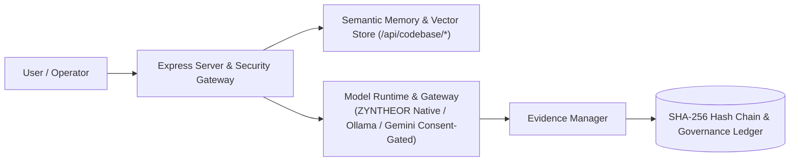

<p align="center">
  
</p>

<p align="center">
  <a href="https://github.com/yutthaphum-phakphian/ZYNTHEOR_AI_ENGINE-"></a>
  <a href="https://github.com/yutthaphum-phakphian/ZYNTHEOR_AI_ENGINE-"></a>
  <a href="https://github.com/yutthaphum-phakphian/ZYNTHEOR_AI_ENGINE-"></a>
  <a href="https://github.com/yutthaphum-phakphian/ZYNTHEOR_AI_ENGINE-"></a>
</p>

<p align="center">
  <a href="https://github.com/yutthaphum-phakphian/ZYNTHEOR_AI_ENGINE-/actions"></a>
  <a href="https://github.com/yutthaphum-phakphian/ZYNTHEOR_AI_ENGINE-/actions"></a>
  <a href="https://github.com/yutthaphum-phakphian/ZYNTHEOR_AI_ENGINE-/actions"></a>
  <a href="https://github.com/sponsors/yutthaphum-phakphian"></a>
</p>

<p align="center">
  <b>Status:</b> Active Governance &amp; Native Core Certified (v1.2.2) &nbsp;|&nbsp; Cryptographic Integrity Baseline &nbsp;|&nbsp; Strict No-Fake Standard
</p>

<p align="center">
  
</p>

<p align="center">
  <a href="#installation">🛠️ Installation & Deployment</a> &nbsp;·&nbsp;
  <a href="#render-deploy">🚀 Render PaaS Deploy</a> &nbsp;·&nbsp;
  <a href="#native-core">🧠 Native Core P5.2</a> &nbsp;·&nbsp;
  <a href="#security">🔒 Security</a> &nbsp;·&nbsp;
  <a href="#architecture">🧭 Architecture</a>
</p>

# ZYNTHEOR AI ENGINE — Sovereign AI Workspace (Buffalo Edition v1.2.2)

ZYNTHEOR AI ENGINE คือระบบพื้นที่ทำงานปัญญาประดิษฐ์วิศวกรรมซอฟต์แวร์แบบประมวลผลภายในเครื่อง (Local-First AI Engineering Intelligence Workspace) ที่ออกแบบมาเพื่อความมั่นคงปลอดภัยขั้นสูง ปริมาณงานสูง และตรวจสอบความถูกต้องเชิงคณิตศาสตร์ได้ในระดับการกำกับดูแลขั้นสูง (Cryptographic Governance Baseline) ขับเคลื่อนด้วย React, TypeScript, Vite, Express, D3.js และ AI Gateway สองโหมด (Local Ollama & Google Gemini API) พร้อมสถาปัตยกรรมโมเดลแกนกลาง ZYNTHEOR CORE Native ที่ผ่านการรับรองหลักฐานความถูกต้องระดับ Level C (P5.2 Evidence Certified)

<p align="center"></p>

## 📊 สรุปผลการตรวจสอบความถูกต้องของระบบ (System Quality & Integrity Baseline)

| หมวดการตรวจสอบ | รายละเอียดและดรรชนีวัดผล | ผลลัพธ์ |
|---|---|---|
| **Code Integrity Manifest** | SHA-256 Fingerprint Baseline (`FILE_MANIFEST.sha256`) | ✅ **Verified (Active Manifest)** |
| **Native Core Evidence** | P5.2 Smoke Test Backpropagation & Checkpoint Hash Verification | ✅ **VERIFIED (SHA: `25781542f1...`)** |
| **Vitest Unit & Integration** | Evidence Manager, Governance Registry, Multi-Provider Audit, Ledger | ✅ **All Suite Tests PASS** |
| **Native Node Test Suite** | Adaptive Modes, Code Intelligence, Routing, Telemetry & Orchestrator | ✅ **All Integration Tests PASS** |
| **TypeScript TypeCheck** | Static Type Analysis (`tsc --noEmit`) | ✅ **0 Errors (Passed Cleanly)** |
| **Production Build** | Vite + React + Express Server Bundle Validation | ✅ **Build Succeeded** |
| **Overall Status** | Buffalo System Governance & Active Upgrade Cycle (v1.2.2) | 🦾 **READY & ACTIVELY UPGRADING** |

<p align="center"></p>

<a id="native-core"></a>
## 🧠 สถาปัตยกรรม ZYNTHEOR CORE Native (Phase P5.2 Evidence Certified)

ZYNTHEOR ยึดมั่นตาม **Strict No-Fake Policy** โมเดลที่นำเสนอทุกตัวจะต้องมีหลักฐานการรันและสิทธิ์ความเป็นเจ้าของจริง (Provenance) โดยในระยะ P5.2 ได้ผ่านการรับรองสถาปัตยกรรมและการฝึกฝนระดับ Level C:

- **สถาปัตยกรรมแกนกลาง**: Native Decoder-only Transformer, RMSNorm, SwiGLU, Rotary Positional Embedding (RoPE), และ Causal Attention
- **การแยกชุดข้อมูลเด็ดขาด (Zero Data Leakage)**: แบ่งข้อมูล 20 เอกสารระดับ SHA-256 เป็น 14 Train (739 tokens), 3 Val (140 tokens), 3 Test (175 tokens) โดย Tokenizer และ Gradient Descent ไม่เคยพบเห็นชุด Test Set
- **การทดสอบความคงตัวเชิงคณิตศาสตร์**: Future-Token Invariance ($\Delta = 0.0$), RoPE Stability (0 NaN/Inf), และ Gradient Finiteness ผ่านการทดสอบครบ 100%
- **หลักฐานการเรียนรู้จริง (Empirical Proof)**: บน Test Set อิสระ โมเดลที่ผ่านการเทรนได้ค่า Cross-Entropy Loss **4.5716** (Perplexity 96.70) ซึ่งต่ำกว่า Random Baseline **4.6146** (Perplexity 100.95)
- **การตรวจสอบ Checkpoint**: ไฟล์ `native_data/p5_2_checkpoint_full.npz` (SHA-256: `25781542f18591134d4d83618c8a8f3d2cdf958c07b0f89ece0c6c0991047c67`) โหลดกลับคืนแล้วให้ค่า Forward Logits ตรงกันสมบูรณ์ ($\text{diff} = 0.0$)
- **เอกสารรับรอง**: อ่านรายงานฉบับเต็มได้ที่ [`native_data/p5_evidence_report.md`](./native_data/p5_evidence_report.md) และ JSON manifest ที่ [`native_data/p5_evidence_report.json`](./native_data/p5_evidence_report.json)

<p align="center"></p>

## 🎨 สถาปัตยกรรม UI & ระบบการแสดงผล (Midnight Teal & Thai-First)

<details>
<summary><b>แสดง/ซ่อนรายละเอียด UI & Typography</b></summary>

### 1. Visual Identity — Midnight Teal System
- **Primary Color Palette**: Deep Navy (`#080F1B`), Midnight Teal (`#0D1828` / `#111F32`), Emerald Glow (`#10B981`), Cyan Highlights (`#38BDF8`), และ Teal Accent (`#14B8A6` / `#2DD4BF`)
- **Zero-Purple Discipline**: กำจัดสีม่วง/ไวโอเลตออกจาก UI ทุกจุดอย่างเด็ดขาด (Headers, Cards, Buttons, Badges, Graphs, Micro-Interactions)
- **Glassmorphic Surface**: พื้นผิวแบบกระจกโปร่งแสง ระดับความคมชัดของขอบสม่ำเสมอ พร้อมองค์ประกอบระดับมืออาชีพ

### 2. Thai-First Localization & Typography
- **Default Language**: ภาษาไทย (`th-TH`) เป็นภาษาหลักในการสื่อสารและแสดงผลระบบ
- **Typography Anti-Clipping**: ใช้ฟอนต์ **Noto Sans Thai** พร้อมกำหนด `line-height: 1.75 - 1.8` และ `letter-spacing: 0.015em` เพื่อป้องกันปัญหาวรรณยุกต์และสระภาษาไทยลอยหรือถูกตัดขอบ
- **Dynamic Language Toggle**: สลับภาษาไทย (TH) และอังกฤษ (EN) ได้แบบเรียลไทม์โดยไม่ต้อง Reload หน้าเว็บ พร้อมบันทึกการตั้งค่าใน `localStorage`

</details>

<p align="center"></p>

## 🛡️ แกนหลักของระบบ Evidence & Cryptographic Governance (Buffalo Edition)

### 1. Evidence Manager Engine
- **SHA-256 Hash Chaining**: เชื่อมโยงทุกเหตุการณ์ Rationale, AST Analysis และ Tool Execution เข้าด้วยกันในสาย Hash Matrix เพื่อตรวจจับการดัดแปลง (Tamper Detection)
- **Automatic Rationale Tracker (`autorationale`)**: บันทึกเหตุผลของ AI ในการเลือก Mode และเลือกใช้ Tool อย่างเป็นระบบ
- **Code Intelligence Evidence (`codeimpact`)**: บันทึกโครงสร้างการเปลี่ยนแปลงข้ามไฟล์ และประเมินความซับซ้อน AST แบบ Real-Time
- **Tool Integrity Verification (`tool_verification`)**: ตรวจสอบ Schema และคำสั่งของเครื่องมือก่อนรันจริง

### 2. Cryptographic Governance Registry
- **Multi-Provider Audit Linkage (`lib/multi-provider-audit.ts`)**: บันทึกการสลับผู้ให้บริการโมเดล AI (Ollama <-> Gemini) พร้อมตรวจสอบลายเซ็น SHA-256 เพื่อความโปร่งใส
- **Governance Ledger (`lib/governance-ledger.ts`)**: สมุดบัญชีการกำกับดูแลที่ไม่สามารถแก้ไขย้อนหลังได้ (Immutable Audit Trail)
- **Governance Registry Gate (`lib/governance-registry.ts`)**: ตรวจสอบระดับความพร้อมของระบบและการตัดสินใจระดับนโยบายความปลอดภัย

### 3. Real-Time Observability Center
- เปิดใช้งาน endpoint `/api/evidence` สำหรับส่งออกรายการหลักฐาน (Evidence Records) และสถานะ Hash Chain แบบ Streaming Real-Time
- หน้าจอแสดงผล Telemetry Monitor สำหรับ GPU/VRAM, Network Latency, Tokens per Second และ Trace Log

<p align="center"></p>

<a id="architecture"></a>
## 🧭 สถาปัตยกรรมภาพรวม (Architecture)



<p align="center"></p>

## 🧩 โครงสร้างโมดูลและหน้าการทำงาน (System Pages & Components)

<details>
<summary><b>แสดง/ซ่อนรายการโมดูลและหน้าการทำงาน</b></summary>

### 1. พื้นที่ทำงาน (Workspace)
- **แชต (Chat)**: ระบบสนทนาวิศวกรรมระดับสูง รองรับโหมด Auto, Chat, Reasoning, Coding, Research และ Agent พร้อมสตรีมมิ่งคำตอบ แสดง Diff, การวิเคราะห์เหตุผล (Reasoning Steps), ตรวจจับความซับซ้อนของโค้ด และการอนุมัติก่อนแก้ไขไฟล์จริง (Approval Gate)
- **โครงการ (Projects)**: บริหารจัดการ Workspace และโปรเจกต์ซอฟต์แวร์หลายโฟลเดอร์ พร้อมระบบ Multi-Workspace Switcher และ Workspace Import/Export
- **แผนงาน (Plans)**: จัดลำดับการพัฒนาซอฟต์แวร์ Dynamic Replanning และ Dependency-Aware Planning เพื่อแยกข้อเท็จจริง (Facts) ออกจากสมมติฐาน (Hypotheses)
- **ไฟล์ (Files)**: เครื่องมือสำรวจ ตรวจสอบ และพรีวิวโค้ดใน Workspace ภายใต้ระบบความปลอดภัย Sandbox ป้องกัน Path Traversal

### 2. ระบบอัจฉริยะ (Intelligence & Models Architecture)
- **Repository Intelligence**: เครื่องมือทำแผนที่โครงสร้างโปรเจกต์ สกัด Symbol, Class, Function, Interface และ Export วิเคราะห์ความสัมพันธ์ระหว่างไฟล์เป็น JSON Context Hierarchy สำหรับ AI
- **Codebase Semantic Search (RAG)**: ระบบสืบค้นและดึงบริบทโค้ดความหมายสูงผ่าน Vector Memory (`/api/codebase/index`, `/api/codebase/search`)
- **Intelligent Debugging**: ระบบวิเคราะห์และสืบสวนข้อผิดพลาด จับ Stack Traces, ดึงไฟล์ที่เกี่ยวข้อง และจัดลำดับสมมติฐานสาเหตุที่แท้จริง (Root Cause Hypotheses) พร้อมคำแนะนำแนวทางแก้ไข
- **Prompt Forge 0.9 PRO**: เครื่องมือออกแบบและพัฒนาพรอมป์ต์ ประกอบด้วย Prompt Optimizer, Rubrics Analyzer, Few-Shot Builder, Variable Simulator และ Test Lab
- **โมเดลและตัวชี้วัด (Models & Architecture)**:
  - **Overview**: ตรวจสอบและตั้งค่า AI Model Endpoint ทั้ง Local Ollama และ Google Gemini API (gemini-3.8-flash)
  - **Model Metrics Rolling Chart**: แผนภูมิแสดงผล Real-Time Rolling 60 นาที ติดตามเวลาแฝง (P50/P95/P99 latency), จำนวน Token (Prompt/Completion) และอัตราความสำเร็จ
  - **Architecture Sub-Tab**: แผนผังความเชื่อมโยงเชิงสถาปัตยกรรมแบบโต้ตอบ (Interactive D3.js Codebase Dependency Map) สร้างขึ้นด้วย `CodeIntelligence.buildDependencyGraph`

### 3. ความเชื่อมั่นและความปลอดภัย (Trust & Safety)
- **สมุดบัญชีตรวจสอบ (Audit Ledger)**: แสดงผล Cryptographic Hash Chain ตรวจสอบความถูกต้อง (Tamper Detection), แสดงกราฟสัดส่วน Event/Action, ตรวจสอบความถูกต้องของ Storage, ส่งออก JSON/CSV และรองรับการ Re-sign ซ่อมแซมสายโซ่
- **การวินิจฉัยระบบ (Diagnostics)**: ตรวจสอบสุขภาพของเซิร์ฟเวอร์, GPU Memory, HTTP Latency, สถานะระบบข้อผิดพลาด และทดสอบการประมวลผล Local/API Inference

### 4. ระบบและการตั้งค่า (System)
- **ระบบการชำระเงินและสิทธิ์ (Billing & Plans)**: บริหารจัดการแผนบริการ (Free / Pro / Enterprise), สิทธิ์การใช้งาน (Entitlements), ข้อมูลการเรียกเก็บเงิน ประวัติ Invoice และสถานะสมาชิก
- **ตั้งค่า (Settings)**: ควบคุม Local-First Isolation Mode, การยินยอมออนไลน์, API Key Security Proxy, การจัดการสิทธิ์การใช้งาน และ Session Management

</details>

<p align="center"></p>

<a id="installation"></a>
## 🛠️ วิธีการติดตั้งและใช้งาน (Local Operations Guide)

### ข้อกำหนดของระบบ (Prerequisites)
- **Node.js**: เวอร์ชัน 20.0.0 ขึ้นไป (แนะนำ 22.x LTS)
- **Package Manager**: npm 10+
- **Local AI Provider**: Ollama (กรณีต้องการรัน Local Inference) หรือ Python 3.9+ (กรณีรันชุด Native Core P5.2)

### ขั้นตอนการรันระบบพัฒนา (Development Mode)
```bash
# 1. ติดตั้ง Dependencies ทั้งหมด
npm install

# 2. คัดลอกและตั้งค่า Environment Variable
cp .env.example .env

# 3. รัน Development Server (Port 3000)
npm run dev
```
เปิดใช้งานผ่านเบราว์เซอร์ที่: `http://localhost:3000`

### การตรวจสอบคุณภาพและทดสอบระบบแบบครบวงจร (Quality Gates & Verification)
```bash
# รันการตรวจสอบแบบรวมทั้งหมด (Preflight + TypeCheck + Test + Build)
npm run verify

# หรือรันแยกแต่ละกระบวนการ:
npm run check:env    # ตรวจสอบสภาพแวดล้อม
npm run typecheck    # ตรวจสอบ TypeScript Types (0 errors)
npm test             # รัน Node Native Tests + Vitest Suite
npm run build        # สร้าง Production Bundle
```

<p align="center"></p>

<a id="render-deploy"></a>
## 🚀 การ Deploy บน Cloud PaaS (Render & Docker)

ระบบรองรับการ Deploy สู่ **Render** ผ่าน Infrastructure as Code ด้วยไฟล์ [`render.yaml`](./render.yaml):

### 1. Render Deployment (Blueprint)
1. Fork หรือ Push โค้ดขึ้น GitHub Repository
2. เข้าสู่ [Render Dashboard](https://dashboard.render.com/) เลือก **New +** $\to$ **Blueprint**
3. เชื่อมต่อ Repository ของคุณ Render จะตรวจพบ `render.yaml` โดยอัตโนมัติ:
   - **Environment**: Node (22.14.0)
   - **Build Command**: `npm install && npm run build`
   - **Start Command**: `npx tsx server.ts`
   - **Health Check Path**: `/api/health`
   - **Auto-generated Secrets**: `ZYNTHEOR_ACCESS_TOKEN` และ `TENANT_STORAGE_HMAC_SECRET` จะถูกสร้างโดยระบบ Render อัตโนมัติอย่างปลอดภัย

### 2. Docker Deployment
```bash
# สร้าง Container Image
docker build -t zyntheor-ai-engine:latest .

# รัน Container
docker run -d -p 3000:3000 \
  -e NODE_ENV=production \
  -e HOST=0.0.0.0 \
  -e ZYNTHEOR_ACCESS_TOKEN=your-secure-token-here \
  zyntheor-ai-engine:latest
```

<p align="center"></p>

<a id="security"></a>
## 🔒 นโยบายความปลอดภัยและการจำกัดขอบเขต (Security & Governance Policy)

- **Security Details**: อ่านรายละเอียดฉบับเต็มได้ที่ [`SECURITY.md`](./SECURITY.md)
- **Local-First Protection**: ระบบรันภายใต้แนวทาง Local-First โดยค่าเริ่มต้น ข้อมูลทั้งหมดจะถูกประมวลผลภายในเครื่องของผู้ใช้
- **Consent-Gated Remote Calls**: การเชื่อมต่อ API ภายนอก (Google Gemini API) จะทำงานเมื่อได้รับอนุมัติจากผู้ใช้ชัดเจนในระบบ
- **Secret Isolation Barrier**: API Keys ทั้งหมดจัดเก็บเฉพาะใน `.env` ฝั่ง Node Express Backend เท่านั้น ไม่มีการส่ง Key ออกไปยัง Client Browser
- **Mandatory Production Access Token**: ใน Production Mode (`NODE_ENV=production`) ระบบจะไม่อนุญาตให้เริ่มทำงานหากไม่มีการกำหนด `ZYNTHEOR_ACCESS_TOKEN`
- **Human Approval Standard**: ปฏิบัติการที่มีผลกระทบต่อระบบซอฟต์แวร์ ต้องได้รับการยืนยันจากมนุษย์ก่อนเสมอ (Human-in-the-loop Gate)

<p align="center"></p>

<a id="contribution"></a>
## 🤝 การมีส่วนร่วมและการพัฒนาต่อยอด (Contributing Guidelines)

คำแนะนำขั้นตอนการพัฒนา, เกณฑ์คุณภาพ (Quality Gates), และระเบียบข้อบังคับ Zero-Purple Discipline สามารถอ่านได้ที่ [`CONTRIBUTING.md`](./CONTRIBUTING.md)
 
<a id="sponsors"></a>
### 💖 การสนับสนุนโครงการ (Sponsorship & Funding)

ร่วมสนับสนุนการวิจัยและพัฒนาสถาปัตยกรรม ZYNTHEOR AI ENGINE เพื่อความก้าวหน้าของระบบปัญญาประดิษฐ์อธิปไตย (Sovereign Local-First AI) และ Native Core Intelligence ได้ผ่านช่องทางดังต่อไปนี้:

- **GitHub Sponsors**: [github.com/sponsors/yutthaphum-phakphian](https://github.com/sponsors/yutthaphum-phakphian)
- **Ko-fi**: [ko-fi.com/zyntheor](https://ko-fi.com/zyntheor)
- **Buy Me a Coffee**: [buymeacoffee.com/yutthaphum](https://buymeacoffee.com/yutthaphum)
- **PayPal**: [paypal.me/yutthaphum](https://paypal.me/yutthaphum)
- **Open Collective**: [opencollective.com/zyntheor-ai](https://opencollective.com/zyntheor-ai)
- **Patreon**: [patreon.com/zyntheor](https://patreon.com/zyntheor)

ดูการตั้งค่า GitHub Funding อย่างเป็นทางการได้ที่ [`.github/FUNDING.yml`](./.github/FUNDING.yml)

<p align="center"></p>

## 📄 License & Attribution

Distributed under the **AGPL-3.0 License**. Built for sovereign, enterprise-grade local-first AI software engineering environments.

<p align="center"></p>

<p align="center">
  
</p>
