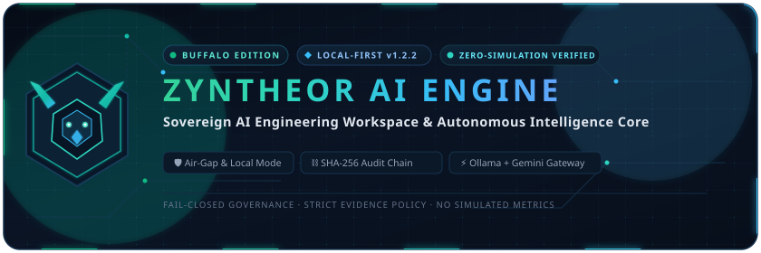
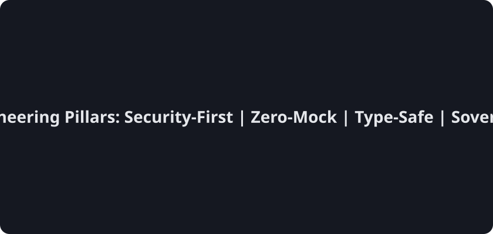
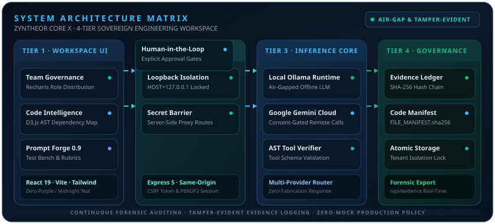

<p align="center">
  
</p>


<p align="center">
  <a href="https://github.com/yutthaphum-phakphian/ZYNTHEOR_AI_ENGINE-/actions/workflows/native-core-1.1.0.yml"></a>
  <a href="https://github.com/yutthaphum-phakphian/ZYNTHEOR_AI_ENGINE-/actions/workflows/audit-1.1.0.yml"></a>
  <a href="https://github.com/yutthaphum-phakphian/ZYNTHEOR_AI_ENGINE-/actions/workflows/codeql.yml"></a>
</p>

<p align="center">
  <b>Status:</b> Active Development &amp; System Upgrades &nbsp;|&nbsp; Cryptographic Integrity Baseline &nbsp;|&nbsp; Sovereign Seal Active
</p>

<p align="center">
  
</p>

<p align="center">
  
</p>

<p align="center">
  <a href="#installation">🛠️ Installation</a> &nbsp;·&nbsp;
  <a href="#security">🔒 Security</a> &nbsp;·&nbsp;
  <a href="#contribution">🤝 Contribution</a> &nbsp;·&nbsp;
  <a href="#architecture">🧭 Architecture</a> &nbsp;·&nbsp;
  <a href="#team-governance">👥 Team Governance</a>
</p>

# ZYNTHEOR AI ENGINE — Sovereign AI Workspace (Buffalo Edition)

ZYNTHEOR AI ENGINE คือระบบพื้นที่ทำงานปัญญาประดิษฐ์วิศวกรรมซอฟต์แวร์แบบประมวลผลภายในเครื่อง (Local-First AI Engineering Intelligence Workspace) ที่ออกแบบมาเพื่อความปลอดภัย ปริมาณงานสูง และตรวจสอบความถูกต้องได้ในระดับการกำกับดูแลขั้นสูง (Cryptographic Governance Baseline) ขับเคลื่อนด้วย React 19, TypeScript, Vite, Express 5, Recharts, D3.js และ AI Gateway สองโหมด (Local Ollama & Google Gemini API)

<p align="center"></p>

## 📊 สถานะการตรวจสอบจริง (Evidence-Based Status)

> สถานะด้านล่างสะท้อนการตรวจสอบ Source Code รอบส่งมอบวันที่ 3 พฤศจิกายน 2026 ไม่ใช่การรับรอง Production Readiness

| ส่วนประกอบ | สถานะปัจจุบัน | ขอบเขตที่ยืนยันได้ |
|---|---|---|
| P11 Cognitive Reasoning | `NOT_VERIFIED` | มีฐานระบบเดิม; ยังไม่มีผล End-to-End Acceptance รอบนี้ |
| P12 Persistent Memory | `PARTIAL / TESTED` | เพิ่ม tenant boundary, corruption fail-closed, atomic write/lock และ legacy-path collision guard; PostgreSQL/Cloud SQL ยังไม่ยืนยัน |
| P13 Multi-Agent | `PARTIAL / TESTED` | มี bounded DAG coordinator, idempotency checks และ human approval gate; durable cross-restart adapter ยังไม่ยืนยัน |
| P14 Evaluation | `PARTIAL / TESTED` | แก้ empty-history scoring; benchmark ระดับโมเดลยังไม่ผ่านการรับรอง |
| P15 Governed Improvement | `NOT_VERIFIED` | มี proposal/approval foundations; end-to-end rollback acceptance ยังไม่ยืนยัน |
| P16 Native Training | `BLOCKED` | มี training loop จริงและ dataset validation 15 samples (8/3/4); provenance และ human review ยังไม่ได้รับอนุมัติ จึงไม่มี checkpoint |
| P17 Native Inference | `BLOCKED` | มี local load/generation runtime; ยังไม่มี checkpoint ที่ตรวจสอบได้ |
| P18 Model Lifecycle | `PARTIAL / TESTED` | มี hash-chained ledger และ promotion/rollback gates; ยังไม่มี model promotion |
| P19 Sovereign Infrastructure | `PARTIAL / TESTED` | มี Local-Only policy และ backup/restore verification; air-gap และ hardened isolation ยังไม่ยืนยัน |
| P20 Integrated Release Gate | `BLOCKED` | มี evidence-derived release gate; release approval ยังปิดอยู่ |

### การทดสอบในรอบนี้

- Targeted Node tests: 33/33 PASS (Memory/Evaluation/No-Simulation 19, Agent/Lifecycle/Platform/Gateway 14).
- Native CPU/Inference Python tests: 12/12 PASS.
- Sovereign backup/restore Python tests: 3/3 PASS.
- Full npm/Vite build และ project-wide test suite: `NOT_VERIFIED` เพราะไม่มี `node_modules` ในสภาพแวดล้อมนี้; ไม่มีการติดตั้ง dependencies เพิ่ม
- Native model training: `BLOCKED` ตาม governance gate; ไม่ได้สร้างหรืออ้างว่าได้ฝึกโมเดลแล้ว

คำสั่งดูสถานะล่าสุด: `npm run corex:p20:status` (สถานะ release ที่คาดหวังคือ BLOCKED จนกว่าจะมีหลักฐานครบทุก gate)

<p align="center"></p>

## 🎨 สถาปัตยกรรม UI & ระบบการแสดงผล (Midnight Teal & Thai-First)

<details>
<summary><b>แสดง/ซ่อนรายละเอียด UI & Typography</b></summary>

### 1. Visual Identity — Midnight Teal System
- **Primary Color Palette**: Deep Navy (`#080F1B`), Midnight Teal (`#0D1828` / `#111F32`), Emerald Glow (`#10B981`), Cyan Highlights (`#38BDF8`), และ Teal Accent (`#14B8A6` / `#2DD4BF`)
- **Zero-Purple Discipline**: กำจัดสีม่วง/ไวโอเลตออกจาก UI ทุกจุดอย่างเด็ดขาด (Headers, Cards, Buttons, Badges, Graphs, Micro-Interactions)
- **Glassmorphic Surface**: พื้นผิวแบบกระจกโปร่งแสง ระดับความคมชัดของขอบสม่ำเสมอ พร้อมองค์ประกอบระดับมืออาชีพ

### 2. Thai-First Localization & Typography
- **Default Language**: ภาษาไทย (`th-TH`) เป็นภาษาหลักในการสื่อสารและแสดงผลระบบ
- **Typography Anti-Clipping**: ใช้ฟอนต์ **Noto Sans Thai** พร้อมกำหนด `line-height: 1.75 - 1.8` และ `letter-spacing: 0.015em` เพื่อป้องกันปัญหาวรรณยุกต์และสระภาษาไทยลอยหรือถูกตัดขอบ
- **Dynamic Language Toggle**: สลับภาษาไทย (TH) และอังกฤษ (EN) ได้แบบเรียลไทม์โดยไม่ต้อง Reload หน้าเว็บ พร้อมบันทึกการตั้งค่าใน `localStorage`

</details>

<p align="center"></p>

## 🛡️ แกนหลักของระบบ Evidence & Cryptographic Governance (Buffalo Edition)

### 1. Evidence Manager Engine
- **SHA-256 Hash Chaining**: เชื่อมโยงทุกเหตุการณ์ Rationale, AST Analysis และ Tool Execution เข้าด้วยกันในสาย Hash Matrix เพื่อตรวจจับการดัดแปลง (Tamper Detection)
- **Automatic Rationale Tracker (`autorationale`)**: บันทึกเหตุผลของ AI ในการเลือก Mode และเลือกใช้ Tool อย่างเป็นระบบ
- **Code Intelligence Evidence (`codeimpact`)**: บันทึกโครงสร้างการเปลี่ยนแปลงข้ามไฟล์ และประเมินความซับซ้อน AST แบบ Real-Time
- **Tool Integrity Verification (`tool_verification`)**: ตรวจสอบ Schema และคำสั่งของเครื่องมือก่อนรันจริง

### 2. Cryptographic Governance Registry
- **Multi-Provider Audit Linkage (`lib/multi-provider-audit.ts`)**: บันทึกการสลับผู้ให้บริการโมเดล AI (Ollama <-> Gemini) พร้อมตรวจสอบลายเซ็น SHA-256 เพื่อความโปร่งใส
- **Governance Ledger (`lib/governance-ledger.ts`)**: สมุดบัญชีการกำกับดูแลที่ไม่สามารถแก้ไขย้อนหลังได้ (Immutable Audit Trail)
- **Governance Registry Gate (`lib/governance-registry.ts`)**: ตรวจสอบระดับความพร้อมของระบบและการตัดสินใจระดับนโยบายความปลอดภัย

### 3. Real-Time Observability Center
- เปิดใช้งาน endpoint `/api/evidence` สำหรับส่งออกรายการหลักฐาน (Evidence Records) และสถานะ Hash Chain แบบ Streaming Real-Time
- หน้าจอแสดงผล Telemetry Monitor สำหรับ GPU/VRAM, Network Latency, Tokens per Second และ Trace Log

<p align="center"></p>

<a id="architecture"></a>
## 🧭 สถาปัตยกรรมภาพรวม (System Architecture Matrix)

<p align="center">
  
</p>

### โครงสร้างสถาปัตยกรรม 4 ระดับ (4-Tier Sovereign Engineering Matrix)

1. **Tier 1: Client Workspace UI (React 19 + Vite + Tailwind + Recharts + D3.js)**
   - **Team Governance & Role Distribution**: แผนภูมิ Recharts (Donut & Bar) วิเคราะห์สัดส่วนบทบาทสมาชิก (Owner, Admin, Developer, Viewer) ภายใน Tenant ปัจจุบัน
   - **Code Intelligence**: แผนผัง AST Dependency Graph เชิงโต้ตอบ พัฒนาด้วย D3.js แสดงการเชื่อมโยง Direct Imports, NPM Dependencies และ Reverse References
   - **Prompt Forge 0.9 PRO**: สตูดิโอออกแบบพรอมป์ต์ขั้นสูง พร้อม Prompt Optimizer, Few-Shot Builder, Variable Simulator และ Test Bench
   - **Chat & Diff View**: สนทนาวิศวกรรมแบบสตรีมมิ่ง โค้ด Diff แบบเทียบเคียง (Side-by-Side / Unified) พร้อมมาตรวัดความซับซ้อน AST แบบเรียลไทม์

2. **Tier 2: Sovereign Security Barrier (Express 5 Node Gateway)**
   - **Loopback Isolation**: ล็อกการ Bind เฉพาะ Loopback Interface (`HOST=127.0.0.1`, `ZYNTHEOR_LOCAL_ONLY=true`) ป้องกันการเข้าถึงที่ไม่ได้รับอนุญาต
   - **Secret Isolation Barrier**: กุญแจ API Keys (รวมถึง Gemini API) จัดเก็บเฉพาะในเซิร์ฟเวอร์หลังบ้าน ไม่ส่งออกไปยังไคลเอนต์เบราว์เซอร์
   - **Same-Origin & CSRF Protection**: ควบคุมการเข้าถึงด้วย HttpOnly/Bearer Token ร่วมกับ Double-Submit Cookie CSRF Token
   - **Human-in-the-Loop Approval Gate**: มาตรการยืนยันการกระทำที่มีผลกระทบสูง (High-Impact Actions) โดยมนุษย์ก่อนเสมอ

3. **Tier 3: AI Inference Core & Gateway Router**
   - **Local Ollama LLM Runtime**: ทำงานแบบออฟไลน์ 100% ไม่พึ่งพาการเชื่อมต่อภายนอก (Air-Gap Ready)
   - **Google Gemini Cloud Gateway**: เชื่อมต่อคลาวด์เฉพาะเมื่อผู้ใช้ให้ความยินยอมชัดเจนล่วงหน้า (Consent-Gated Remote Calls)
   - **AST & Tool Verifier**: ตรวจสอบความถูกต้องของคำสั่ง Tool และวิเคราะห์ Syntax Tree ก่อนส่งให้ระบบประมวลผลจริง

4. **Tier 4: Cryptographic Governance & Storage Layer**
   - **Evidence Ledger (`/api/evidence`)**: บันทึกหลักฐานต่อเนื่องด้วย SHA-256 Hash Chaining ตรวจสอบการดัดแปลงข้อมูลได้ทันที (Tamper-Evident)
   - **Code Integrity Manifest (`FILE_MANIFEST.sha256`)**: บันทึกและตรวจสอบ Checksum ทุกไฟล์สำคัญในโปรเจกต์
   - **Tenant-Segregated Atomic Storage**: จัดเก็บข้อมูลแยกตาม Tenant ด้วยกลไก Atomic Write และ File Lock ป้องกัน Race Condition

<p align="center"></p>

## 🧩 โครงสร้างโมดูลและหน้าการทำงาน (System Pages & Components)

<details>
<summary><b>แสดง/ซ่อนรายการโมดูลและหน้าการทำงาน</b></summary>

### 1. พื้นที่ทำงาน (Workspace)
- **แชต (Chat)**: ระบบสนทนาวิศวกรรมระดับสูง รองรับโหมด Auto, Plan และ Code มีระบบ Streaming Diff, AST Complexity Preview และ Reasoning Steps
- **โครงการ (Projects)**: บริหารจัดการโครงการซอฟต์แวร์ ติดตามสถานะ ความคืบหน้า และเกณฑ์การส่งมอบ
- **แผนงาน (Plans)**: จัดลำดับการพัฒนาซอฟต์แวร์ แยกข้อเท็จจริง (Facts) ออกจากสมมติฐาน (Hypotheses)
- **ไฟล์ (Files)**: เครื่องมือสำรวจโครงสร้างโค้ดปลอดภัยในรูปแบบ Read-Only

### 2. ระบบอัจฉริยะ (Intelligence & Models Architecture)
- **Prompt Forge 0.9 PRO**: เครื่องมือออกแบบและพัฒนาพรอมป์ต์ ประกอบด้วย Prompt Optimizer, Rubrics Analyzer, Few-Shot Builder, Variable Simulator และ Test Bench
- **โมเดลและการวิเคราะห์สถาปัตยกรรม (Models & Architecture Tab)**:
  - **Overview**: ตรวจสอบและตั้งค่า AI Model Endpoint ทั้ง Local Ollama และ Google Gemini API
  - **Architecture Sub-Tab**: แผนผังความเชื่อมโยงเชิงสถาปัตยกรรมแบบโต้ตอบ (Interactive D3.js Codebase Dependency Map) สร้างขึ้นด้วย `CodeIntelligence.buildDependencyGraph`
  - **Interactive Module Exploration**: เมื่อคลิกเลือกโมดูล node บนกราฟ จะเน้น (Highlight) สายสัมพันธ์ direct imports และโมดูลที่เกี่ยวข้อง พร้อมแสดงแถบข้าง (Sidebar Panel) ตารางกรองข้อมูล:
    - *Direct Internal Imports*: โมดูลภายในที่ไฟล์นี้เรียกใช้
    - *External Dependencies*: NPM Libraries ภายนอกที่ถูกนำเข้า
    - *Reverse Imports (Imported By)*: รายการไฟล์ภายในที่เรียกใช้งานโมดูลนี้

### 3. ความเชื่อมั่นและความปลอดภัย (Trust & Safety)
- **สมุดบัญชีตรวจสอบ (Audit Ledger)**: แสดงผล Cryptographic Hash Chain ของระบบ สามารถตรวจสอบย้อนหลังได้ทุก Transaction
- **การวินิจฉัยระบบ (Diagnostics)**: ตรวจสอบสุขภาพของเซิร์ฟเวอร์, GPU Memory, HTTP Latency และทดสอบการประมวลผล Local Inference

### 4. การตั้งค่า (System Settings)
- **ตั้งค่า (Settings)**: ควบคุม Local-First Isolation Mode, การยินยอมออนไลน์, API Key Security Proxy และการจัดการสิทธิ์การใช้งาน

</details>

<p align="center"></p>

## 📱 ภาพหน้าจอ (Screenshots)

> 🚧 **ยังไม่มีภาพหน้าจอจริง** — วางไฟล์ภาพจริงจากแอปที่ `docs/screenshots/` แล้วเปิดคอมเมนต์ด้านล่าง ห้ามใช้ภาพจำลองแทน

<!--
<p align="center">
  
  
  
</p>
-->

<p align="center"></p>

<a id="installation"></a>
## 🛠️ วิธีการติดตั้งและใช้งาน (Local Operations Guide)

### ข้อกำหนดของระบบ (Prerequisites)
- **Node.js**: เวอร์ชัน 20.0.0 ขึ้นไป
- **Package Manager**: npm 10+
- **Local AI Provider**: Ollama (กรณีใช้งาน Local Inference)

### ขั้นตอนการรันระบบพัฒนา (Development Mode)
```bash
# 1. ติดตั้ง Dependencies ทั้งหมด
npm install

# 2. คัดลอกและตั้งค่า Environment Variable
cp .env.example .env

# 3. รัน Development Server (Port 3000)
npm run dev
```
เปิดใช้งานผ่านเบราว์เซอร์ที่: `http://localhost:3000`

### การตรวจสอบคุณภาพและทดสอบระบบ (Quality Gates & Testing)
```bash
# 1. ตรวจสอบ Static Type Check (TypeScript)
npm run typecheck

# 2. ตรวจสอบ Code Integrity Manifest (SHA-256 Hashes)
node scripts/check-manifest.js

# 3. รัน ชุดการทดสอบ Unit & Governance Tests (Vitest)
npm run test

# 4. ทดสอบสร้าง Production Bundle
npm run build
```

<p align="center"></p>

<a id="security"></a>
## 🔒 นโยบายความปลอดภัยและการจำกัดขอบเขต (Security & Governance Policy)

- **Security Details**: อ่านรายละเอียดฉบับเต็มได้ที่ [`SECURITY.md`](./SECURITY.md)
- **Local-First Protection**: ระบบรันภายใต้แนวทาง Local-First โดยค่าเริ่มต้น ข้อมูลทั้งหมดจะถูกประมวลผลภายในเครื่องของผู้ใช้
- **Consent-Gated Remote Calls**: การเชื่อมต่อ API ภายนอก (Google Gemini API) จะทำงานเมื่อได้รับอนุมัติจากผู้ใช้ชัดเจนในระบบ
- **Secret Isolation Barrier**: API Keys ทั้งหมดจัดเก็บเฉพาะใน `.env` ฝั่ง Node Express Backend เท่านั้น ไม่มีการส่ง Key ออกไปยัง Client Browser
- **Human Approval Standard**: ปฏิบัติการที่มีผลกระทบต่อระบบซอฟต์แวร์ ต้องได้รับการยืนยันจากมนุษย์ก่อนเสมอ (Human-in-the-loop Gate)

### Security - Local Only
This server binds to loopback by default (127.0.0.1) and do not expose it directly to the internet.
Use ZYNTHEOR_LOCAL_ONLY=true and HOST=127.0.0.1 to enforce local-only mode.
For hosted-preview, override HOST=0.0.0.0 with explicit consent.

<p align="center"></p>

<a id="contribution"></a>
## 🤝 การมีส่วนร่วมและการพัฒนาต่อยอด (Contributing Guidelines)

คำแนะนำขั้นตอนการพัฒนา, เกณฑ์คุณภาพ (Quality Gates), และระเบียบข้อบังคับ Zero-Purple Discipline สามารถอ่านได้ที่ [`CONTRIBUTING.md`](./CONTRIBUTING.md)

<p align="center"></p>

## 📄 License & Attribution

Distributed under the **AGPL-3.0 License**. Built for sovereign, enterprise-grade local-first AI software engineering environments.

<p align="center"></p>

<p align="center">
  
</p>


<a id="team-governance"></a>
## 👥 การบริหารจัดการทีมและการกำกับสิทธิ์ (Team Governance & Access Control)

ระบบจัดการทีม (Team Management) ของ ZYNTHEOR ยกระดับจากการจัดการบัญชีทั่วไปสู่ **Access Governance Dashboard** ที่ตรวจสอบสิทธิ์ได้โปร่งใสและปลอดภัย:

### 1. การแสดงผลบทบาทสมาชิกด้วย Recharts (`TeamRoleDistributionChart`)
- **Donut & Bar Chart Mode**: สลับมุมมองระหว่างกราฟโดนัท (Donut Chart) และกราฟแท่ง (Bar Chart) ได้ทันที
- **Role Breakdown**: จำแนกตาม 4 บทบาทหลัก:
  - **Owner (`#14b8a6`)**: อำนาจสูงสุดของ Workspace กำกับดูแลนโยบาย Sovereign AI
  - **Admin (`#38bdf8`)**: จัดการสมาชิกและความปลอดภัยของ Tenant
  - **Developer (`#818cf8`)**: วิพัฒนาการเชื่อมต่อ Model Pipeline และระบบวิศวกรรม
  - **Viewer (`#94a3b8`)**: สิทธิ์อ่านและตรวจสอบ Forensic Audit เท่านั้น
- **Interactive Tooltips & Zero-State**: แสดงสถิติจำนวนคนและสัดส่วนเปอร์เซ็นต์อย่างถูกต้อง พร้อมรับมือกรณีที่ไม่มีสมาชิก (Zero-State) โดยไม่เกิดข้อผิดพลาด

### 2. บัตรสรุปสถิติบทบาท (Role Summary Breakdown Cards)
- แสดงจำนวนสมาชิกจริงจำแนกตามแต่ละ Role (Owner, Admin, Developer, Viewer)
- สรุปจำนวนสมาชิกรวมใน Workspace ปัจจุบัน พร้อมแสดงบทบาทของผู้ใช้ที่เข้าสู่ระบบ
- แยกขอบเขต Tenant ชัดเจน (Tenant-Isolated) ไม่ปะปนข้อมูลข้ามองค์กร

### 3. มาตรการความปลอดภัยของ Session ฝั่งเซิร์ฟเวอร์
- การดึงรายชื่อสมาชิกและการปรับสิทธิ์จะถูกบังคับใช้ผ่าน Server-Side Session (`/api/auth/members` และ `PATCH /api/auth/members/:id/role`)
- ป้องกันการปลอมแปลง Role Header จากเบราว์เซอร์ พร้อมระบบป้องกัน CSRF
- บันทึกประวัติการปรับสิทธิ์ลงใน Cryptographic Audit Ledger อย่างต่อเนื่อง

<p align="center"></p>

## 📋 แผนงานและผลการตรวจสอบสถาปัตยกรรม (P4–P10 Audit & Roadmap)

เอกสารการตรวจสอบอิสระและแผนงานระยะยาวฉบับสมบูรณ์:
- **Audit Basis**: ตรวจสอบตามผลส่งมอบและสัญญาเชิงสถาปัตยกรรม (P4 Evaluation, P5 Self-Improvement, P6 Native Training, P7 Inference, P8 Evolution, P9 Sovereign Infra, P10 Platform Gate)
- **Source of Truth**: [`docs/roadmap/ZYNTHEOR_CORE_X_P4_P10_AUDIT_AND_PLAN.md`](./docs/roadmap/ZYNTHEOR_CORE_X_P4_P10_AUDIT_AND_PLAN.md)
- **Security Hardening**: [`docs/audit/IDENTITY_STORAGE_HARDENING_2026-11-03.md`](./docs/audit/IDENTITY_STORAGE_HARDENING_2026-11-03.md)

<p align="center"></p>

<p align="center">
  
</p>

